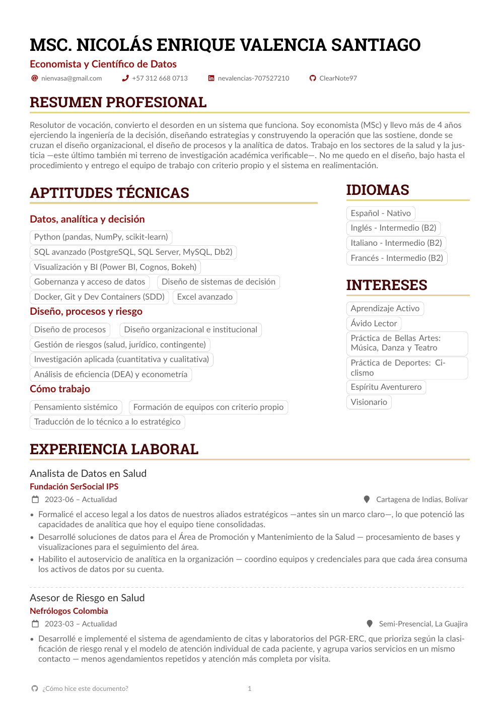
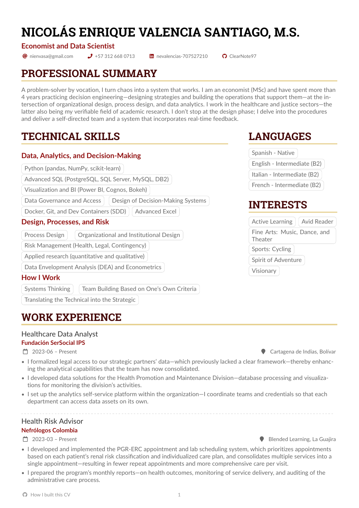

<div align="center">

# 📄 AutoCV

**Mi hoja de vida como *código*: datos en YAML → un comando → PDF profesional y bilingüe (ES/EN).**

_Lo que quiero mostrar acá es el **método**: tratar un documento personal como software —
versionado, reproducible y con una sola fuente de verdad en vez de pelear con un Word._


<br>



</div>

> 👋 **¿Quieres conocer mis otros proyectos?** → **[github.com/ClearNote97](https://github.com/ClearNote97)**

---

Soy economista y científico de datos. Mantener mi CV en Word era un dolor: un cambio descuadraba el
formato y tener la versión en inglés al día era duplicar el trabajo. Así que lo convertí en **datos** y
escribí este generador: edito mi información en YAML y, con **un comando**, obtengo el PDF en español e
inglés. Este repo es ese generador — y, sobre todo, el **cómo** lo hice.

---

## 🧩 El problema

> **Un CV en Word es frágil, monolingüe por defecto y no tiene historial.**

Mover una línea descuadra el diseño. Mantener dos idiomas es copiar-pegar-y-rezar. Y no hay forma de ver
qué cambió entre una versión y otra. El contenido (lo que digo) está enredado con la presentación (cómo
se ve), así que no puedo tocar uno sin romper el otro.

---

## 🧠 Cómo lo resolví

El valor está en el método — tratar el CV como software:

1. **Separé contenido y presentación.** Mi información vive en `data/es/*.yaml` (una sección por archivo);
   el diseño vive en una plantilla LaTeX. Ninguno sabe del otro.
2. **Una sola fuente de verdad.** El **español es la fuente**; el **inglés se deriva** con la API de DeepL.
   Escribo una vez, no dos.
3. **Traducción que respeta la cuota.** DeepL **en lote** (una llamada por documento) con **cache por hash**:
   solo re-traduce lo que cambió.
4. **Traducción con criterio.** Los **nombres propios** (empresas, instituciones) y los identificadores
   (emails, URLs) **no se traducen**; un **glosario** corrige términos ambiguos (ej. *"Actualidad" → "Present"*,
   no *"News"*). Los **títulos de sección** cambian de idioma por diccionario (i18n), no por traducción.
5. **Un solo comando reproduce todo.** `autocv build` encadena cargar → traducir → renderizar → compilar.
   Mismo input ⇒ mismo PDF, en cualquier máquina (Dev Container).
6. **Calidad tipográfica de verdad.** LaTeX + la plantilla [AltaCV](https://github.com/liantze/AltaCV),
   compilado con `latexmk` (que orquesta `biber` para que las publicaciones resuelvan).
7. **Primero el contrato, luego el código.** Se construyó bajo **Spec-Driven Development**: en
   [`spec/`](./spec/) está lo que *debe* ser verdad antes de escribir una línea.

> 🤖 Trabajé esto con un agente de IA (**Claude Code**): yo dirijo — defino el problema, decido el diseño
> y reviso cada paso; el agente ejecuta y deja todo trazado.

---

## 👀 Un vistazo

<div align="center">

| 🇪🇸 Español | 🇬🇧 English |
|:---:|:---:|
|  |  |

_Mismo contenido, una sola fuente. El inglés se genera del español — títulos, categorías y cuerpo
traducidos; empresas y fechas, intactas._

</div>

---

## ▶️ Cómo correr

Todo corre **dentro de un Dev Container** (VS Code + Docker): no instalas Python ni TeXLive en tu máquina,
viven en el contenedor.

**Requisitos:** [Docker](https://www.docker.com/) (en Windows, vía WSL2), [VS Code](https://code.visualstudio.com/)
con la extensión [Dev Containers](https://marketplace.visualstudio.com/items?itemName=ms-vscode-remote.remote-containers), y Git.

```bash
# 1. Clonar y entrar
git clone https://github.com/ClearNote97/Auto_CV.git
cd Auto_CV

# 2. Abrir en VS Code → Ctrl+Shift+P → "Dev Containers: Reopen in Container"
#    (la primera vez construye la imagen con Python + TeXLive; tarda un poco)

# 3. (solo para el inglés) tu API key de DeepL
cp .env.example .env     # y pon tu DEEPL_API_KEY — el plan Free alcanza

# 4. Generar el CV — un solo comando (uv ya instaló las deps al abrir el contenedor)
uv run python -m src.autocv.cli build --lang both
```

> Gestión de dependencias con **[uv](https://docs.astral.sh/uv/)** (`pyproject.toml` + `uv.lock`). Al abrir el
> Dev Container se corre `uv sync` solo; para generar basta `uv run`.

**Opciones** (sobre `uv run python -m src.autocv.cli`):

| Comando | Qué hace |
|---|---|
| `build --lang es` | Solo español → `CV_Nombre.pdf` *(no necesita API key)* |
| `build --lang en` | Solo inglés → `CV_Nombre_eng.pdf` |
| `build --lang both` | Ambos idiomas |
| `build --force` | Re-traduce todo, ignorando la cache |

---

## 📦 Qué produce (en `output/`)

- **`CV_Nombre.pdf`** — el CV en español.
- **`CV_Nombre_eng.pdf`** — el CV en inglés, derivado del español.

Un CV de calidad tipográfica (LaTeX/AltaCV): dos columnas, aptitudes por categorías, marca de agua y
numeración desde la 2ª página, publicaciones resueltas con `biber`.

---

## 🗂️ Estructura

```
.
├── src/autocv/          # el pipeline: config → data_loader → translator → renderer → pdf · cli
├── src/frontend/
│   └── templates/cv_ds/ # la capa de presentación: plantilla LaTeX (altacv) + cv_template.tex (Jinja)
├── data/es/             # ★ la fuente: mi CV en YAML por sección (el inglés se deriva a data/en/)
├── config/              # config.yaml (rutas, etiquetas i18n) + deepl_config.yaml (no-traducir, glosario)
├── spec/                # Spec-Driven Development: constitución + feature 001 (spec·plan·tasks)
├── docs/
│   └── AutoCV-legacy/   # el primer intento, con su narración honesta de qué salió mal
├── output/              # el producto (PDFs) — artefacto, no se versiona
└── .devcontainer/       # entorno reproducible (Python + TeXLive + biber + latexmk)
```

---

## 🛠️ Stack

**Python 3.13** · **PyYAML** (datos) · **Jinja2** (render) · **DeepL** (traducción) ·
**LaTeX / [AltaCV](https://github.com/liantze/AltaCV)** + `latexmk` + `biber` (PDF) · **Dev Container + Docker**.

**Plantilla base:** [ClearNote_Dev](https://github.com/ClearNote97/ClearNote_Dev) — mi plantilla insignia de
desarrollo full-stack en Python bajo Spec-Driven Development. AutoCV se construyó sobre ella, pero **sin** su
capa de base de datos: es una herramienta, no una app con backend.

---

## 🙏 Créditos

- **Autor:** MSc. Nicolás Enrique Valencia Santiago.
- **Par de trabajo:** agente de IA (Claude / Claude Code, en el marco [Helix](https://github.com/ftuga/helix_asisten) de [ftuga](https://github.com/ftuga)).
- **Plantilla LaTeX:** [AltaCV](https://github.com/liantze/AltaCV) (LPPL) · **Traducción:** [DeepL](https://www.deepl.com/).

## ⚖️ Licencia

[MIT](./LICENSE) para el código de AutoCV. La plantilla AltaCV mantiene su propia licencia (LPPL).
